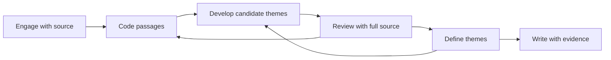
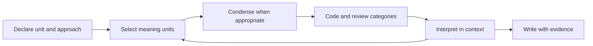
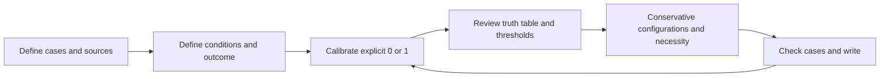

# Research report · explicit method and process diagram

18 October 2026. Owner-requested presentation extension discovered during [UX55](UX-55-INPUT-RECOVERY-ACCEPTANCE.md). **Design only; not implemented.** The current round prohibits feature edits. No statistic, calibrated membership, counting definition or plotting path may change for this work.

## One report family

Use **Research report** as the common user-facing name. A saved method determines its subtitle and its chapters. `qca-report.docx` in the review pack is a Comparative QCA sample; it is not an additional report that every Content / TA user must write. Coded source notebook and the five figure bundles remain separate deliverables, with optional figures/evidence in the report ZIP. Full project JSON is the workspace recovery file; Word is an editable writing copy and does not update QT.

## Method and decisions block

Keep this block visible even when authored notes are blank:

1. **Method used:** full saved `draft.method` label, never guessed from file names or tree depth. Comparative adds “binary crisp-set, conservative, no logical remainders.”
2. **Approach and decisions:** researcher-written approach, analysis unit, context/assumptions and method notes. Empty fields say “Not documented yet.” TA subtype / CA approach remain unspecified until the researcher records them; the tool must not assert that all TA is reflexive TA.
3. **Process map:** a compact original engineering-style flow, with readable text and an equivalent linear text description. It is an overview of the chosen procedure, not proof that the researcher completed every stage. Display it as **Method map M1**, separate from the five descriptive figures.
4. **Provenance:** saved report version, method-map schema/version and actual frozen source/run binding. Preserve old report content until an explicit save or refresh. External Word edits stay in Word.

Do not infer completed stages from a Read mark, a memo timestamp, a nonempty tree or a count. A future stage status can only mean explicit researcher confirmation or a genuinely recorded operation. Do not claim automatic credibility, saturation, ethical approval, causal proof or all-method certification.

## Three distinct maps

These are proposed original layouts, not copied figures. The exact approach must be declared alongside the map.

**TA:** common guide: engage with data → code → develop candidate themes → review with source → define themes → write. Include return arrows to show review and revision. If the researcher explicitly chooses reflexive TA, name that variant and cite Braun & Clarke’s [author guidance](https://www.thematicanalysis.net/doing-reflexive-ta/), which describes a recursive rather than rigid sequence. This is not an automatic theme-generation feature.

**Qualitative Content Analysis:** state the analysis unit and declared approach, then meaning units → condense when appropriate → code → develop/review categories → contextual interpretation and writing. Theme interpretation is optional according to the design and level of abstraction; it is not a mandatory extra tree level. This plan is informed by Graneheim / Lundman and colleagues’ discussion of meaning units, abstraction, categories and themes in the [original 2004 paper](https://doi.org/10.1016/j.nedt.2003.10.001) and [2020 methods paper](https://www.sciencedirect.com/science/article/abs/pii/S0020748920301164). CA remains a complete method, not a compulsory pre-stage for TA or Comparative QCA.

**Comparative QCA:** explicit cases / sources → condition and outcome definitions → researcher 0/1 calibration with reasons → truth table and thresholds → conservative configurations / necessity checks → inspect counterexamples and write. Show the saved run ID, direction and cutoffs from the existing frozen run. Missing prevents execution. The ordering follows calibrated data into a [truth table](https://search.r-project.org/CRAN/refmans/QCA/html/truthTable.html) and then [minimisation](https://search.r-project.org/CRAN/refmans/QCA/html/minimize.html). This does not add fuzzy sets, PRI, intermediate/parsimonious solutions or automatic causal claims.

## Implementation and synchronisation boundaries

- Add a small shared semantic method-map definition and version; project/report data must preserve the selected method and deliberately saved map, not depend on a future website-only copy. Define compatibility for existing saved reports before changing the allowed report schema.
- Workbench report editor shows the selected full method beside its approach and notes. Preview and exports use the **saved** method; dirty form edits must not silently relabel an old exported calculation.
- HTML uses original SVG/text plus accessible ordered steps, keyboard-readable and static under reduced motion. Mobile wraps or stacks the map without clipping or shrinking labels.
- Word uses native editable text and connectors or an equivalent editable structured layout. Diagram text must be large enough to read, remain together/continue clearly across pages, and avoid floating-image overlap. Preserve exact source quotations, numeric tables and original five figure recipes.
- Website Methods / Export explanation uses the same method names and honest scope. It can show the three different maps, but must not imply that a user runs all three methods or receives two mandatory overall reports. Existing sketches, original report, recordings, count tables and downloads remain.

## Acceptance before closing UX55-04

1. TA, Content and Comparative reports each show the correct saved full method inside Method and decisions, even with blank notes; method switching retains writing and visibly changes the relevant map on save.
2. The right map appears in workbench preview, self-contained HTML, editable Word, JSON and report ZIP; old report versions and frozen runs remain identifiable and restore without silent relabelling.
3. Word text/connectors remain editable after save/reopen; every rendered page is inspected. Desktop / phone / keyboard / accessibility / reduced-motion and console checks pass.
4. Existing original sources, highlighted ranges, CSVs, computed QCA results, five figure members and code hashes remain equal. New presentation never runs another analysis.
5. Website wording and workbench support agree; no new capability is called available until its actual tests and outputs pass. All examples use disposable public Bologna copies, Windows deferred, no push/deployment without renewed instruction.
