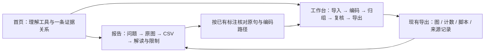
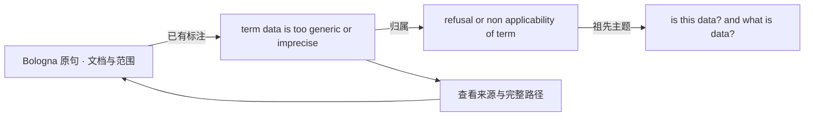

# UX-01 · 整体体验蓝图与首页 / Coding 方案

2026-10-15，原始设计方案。**后续 UX-03A 已实现首页精简与 Coding 样板，见[验收](UX-03A-HOME-CODING.md)；其他阶段状态以总计划为准**。依据 [本轮走查](UX-01-WALKTHROUGH.md)，推进状态与验收维护在 [总计划](EXPERIENCE-ROADMAP.md)。

## 一条体验主线，三个使用场景

用户想要的是 Pi 的简洁表达加上阶跃报告的专业图表与连续阅读。建议借鉴信息层次与交互组织：Pi 的短标题和分段说明；阶跃报告的章节问题、图表读值、表格与方法索引。参考站本身也有长内容，不能把“简洁”理解为照搬它的总长度，更不能复制字体、图标、文案、代码或图形资产。

2026-10-15 参考：[Pi](https://pi.dev/)、[阶跃入口](https://www.stepfun.com/step-5-preview)、[交互报告](https://www.stepfun.com/assets/ai-opinion-report-MY2QF7cY.html)。报告正文经浏览器打开核对：章节问题、图/表索引与图上选择控件共同组织阅读。本方案采用这种组织原则，不采用其数据、观点或视觉资产。



图中报告到原句的完整闭环属于待实施部分；现有报告只有部分图表读值，当前不会直接带出完整证据。

| 场景 | 用户此刻的问题 | 默认展示 | 深入入口 | 设计取舍 |
| --- | --- | --- | --- | --- |
| 首页 | 它帮我做什么？记录是否可核查？ | 一条可读原句、一条编码路径、短说明 | 真实操作录像 / 示例报告 / 只读演示 | 少文字，解释关系；详细方法可展开 |
| 报告 | 图上是什么数字？这些数字能说明什么？ | 章节问题、原 SVG、关键读值和单位 | 完整 CSV 表、下载、方法、有限例证 | 专业来自准确与可追溯，不靠换图型 |
| 工作台 | 我现在编码哪句话？归在哪个主题？如何复核？ | 高对比原文、准确范围、边栏、可用编码树 | 证据列表、关系图、审计、导出 | 操作清晰与长时阅读优先；不堆叠长篇说明 |

统一的对象始终是：**来源文档及范围 → 标注关联 → 稳定编码 ID → 祖先路径**。名称是显示文字，不是身份。AI 建议、已确认标注、研究者原始导入编码须清楚区分。

## 首页精简方案

保留现有六区块骨架；把说明由默认全展开改为有层次的阅读。不是删掉方法、来源或产品边界。实施前需明确本方案对旧 T7 任务单中“默认视频、每步三条操作文字”等部分的调整范围。

| 区块 | 默认内容 | 展开 / 次入口 | 验收要点 |
| --- | --- | --- | --- |
| 导航 | 精简为 Workflow / Example report / Method / About 等清晰任务名，保留 Data 与反馈的可达入口 | 具体命名在实施轮统一；不把报告称作通用 Docs | 链接目的与实际页面一致；手机菜单与键盘可达 |
| 首屏 | 一句价值主张、一短句解释、本地优先事实、两个真实可用的入口 | 下载的 Windows 未验证状态保留；不得假装已可下载 | 首屏能回答“做什么、数据在哪、下一步去哪”；不新增能力承诺 |
| 五步工作流 | 默认一张简洁关系解释；Coding 是核心样板；每步一句目标 + 一句可见结果 | 看真实操作视频、静态图；需要操作说明再展开 | 视频与图解释不同问题；切换不劫持滚动；步骤名不混淆能力块 |
| 方法 | 两张简短方法摘要，清楚标明工具支持程度 | 现有完整 TA/CA 对照表与参考文献全部保留 | 不把计数说成意义/重要性，不把有备忘录说成已完成反身性分析 |
| 边界 | 四条短立场 | 原理由、替代路径、修订历史；快照入口的宽屏范围说明 | 依据 NOT_BUILDING 的四条立场，旧设想不冒充已实现功能 |
| 数据与页脚 | 优先显示本页实际使用的 Bologna 卡片、许可与来源 | 其他既有数据卡片可展开，完整来源与哈希仍可到达 | 继续使用生成卡片；不在网站另写卡片、单位句或统计 |

默认可见文字目标：**650–800 个英文词**；当前同口径 1,315。实施时用 `document.body.innerText.trim().split(/\s+/).length` 在相同初始状态统计，含导航与页脚；展开后的完整资料单独记录，不能靠把必要说明藏到不可达位置凑数字。

简化后的桌面结构示意：

```text
QualiCraft                            Workflow  Example report  Method …

一句价值主张
一短句说明                         [只读演示]  [查看示例报告]
下载状态如实保留

┌─────────────────────────┐   01 Import   一句目的与结果
│ Bologna 的一条原句        │   02 Coding   原句 → 编码 → 主题
│ 高亮 → 编码 → 祖先路径     │   03 Analysis  已有计数与限制
│ [上一步] [下一步]          │   04 Plotting  五类原有图
│ [看真实操作] [静态说明]     │   05 Export    可携带的记录
└─────────────────────────┘

一张来自现有报告的真实图 + “检查计数与方法”入口
两种方法摘要 [完整对照]  四条边界 [理由与历史]
Bologna 来源卡 [其他来源]  许可 / 引用 / 反馈
```

可用入口与文案是提案，不能在 Windows 门禁未过时启用下载；只读示例关系演示也不能伪装为已保存到工作台的编辑操作。

## 左侧演示：简洁关系解释为主，真实录屏为辅

用户扫首页时，整个工作台缩到半栏，原文与控件很难读；小动画更适合解释“同一句、一个编码、一个主题路径”的关系。视频更适合证明“这个操作确实能在真实产品中完成”。因此两者都保留，承担不同任务。

- 默认：少量原生 HTML/SVG 文字和连线，始终能读清原句；用户操作后再改变选择状态，不自动轮播。
- 次入口：按需播放现有五段真实录屏；保留原生控制、静态替代与全尺寸查看。Coding 现有片段主要展示结果，不能宣称它录到了完整新建编码过程。
- 如果日后补录选区→赋码→归组的完整操作，仍只用 Bologna，继续验“无汉字、结果可见、无灰罩”。本轮不重录。
- 两种展示清楚标为“关系示意”和“真实工作台录屏”。示意是可验证的解释图，不画一个可编辑的假工作台，也不伪造保存成功提示。

## Coding 样板：以原有 Bologna 标注为依据

正式样板不使用本轮临时项目里的 `Review ·` 测试标签。建议先用一条已有研究者标注，证明路径而非发明主题。

| 字段 | 已核对的来源 |
| --- | --- |
| 文档 | `interview03.txt`，ID `7df6d4687c814b188de6db5a9ef97611` |
| 文档文本 SHA-256 | `9eb6536a63821fca540b0bc36ab51a64e23b9d80cfbb03cd084345d1761a6670` |
| 标注 | `1777fabb3fc0461b88e972664b078e03`，source=`imported` |
| 范围 | Unicode 字符 `[26013,26090)`，与原文切片一致 |
| 原句 | ma è impreciso il termine data. Se lo si intende solo in termini commerciali. |
| 编码 | `term data is too generic or imprecise`，ID `080e089a9fdc4b2787bd48f05dc83711` |
| 上级路径 | `is this data? and what is data?` → `refusal or non applicability of term` → 该编码 |

这条原句是 CC0 原文，保留意大利语；英文界面不能把改写后的英语当作原句。依据记录在证据目录 `data-audit.json::reference_example`。需要两码重叠示例时，再从原始标注中挑真实存在的例子并核对，不能给这句话虚构第二个标签。



四个状态足够解释核心，不先做自由拖拽网络：

| 状态 | 左侧变化 | 右侧短说明 | 操作与静态退路 |
| --- | --- | --- | --- |
| 1 看原句 | 原文、文档名与简洁来源提示 | 从具体文本开始 | 默认就可阅读；无脚本时保留这一段及路径 |
| 2 看编码 | 准确范围高亮，出现原有编码 | 一个标签连接到一处来源 | 点/触摸编码，或键盘 Next / Enter |
| 3 看主题 | 显示完整祖先路径、对应连线 | 主题组织编码，编码保留原句 | 点祖先可看定义；无定义时如实说明，不能编造 |
| 4 核查来源 | 展开文档、范围、来源类型与返回 | 随时回到证据 | 明确“查看示例来源”；工作台定位尚未实现时不做失效跳转 |

选中状态同时用文字、线形/描边表达，不能只换颜色。Tab 可进入和离开控件；上/下一步、Enter、Escape 清除或收起；切换状态宣布当前选择，不能把焦点扔到页面开头。手机改为原句→编码→路径纵向排列，控件至少 44px；长标签换行，完整文字始终可读。

动效仅帮助看懂状态变化：连线/选中提示轻微变化，不晃动文字、不持续漂移、不自动跳步骤。时长遵守现有 T7 规格；减少动态效果时直接呈现。静态图与文字路径必须独立成立。

## 报告五图的下一步

| 图 | 当前 | 下一步 | 不变的边界 |
| --- | --- | --- | --- |
| 频次 | 已有读值与表格行联动 | 保持并回归 | 读现有 CSV；频次不等于重要性或人数 |
| 覆盖 | 原图、表、下载已有 | 选单元格→准确 case/code/count→对应行 | 不加分组统计，不把标注数改成人数 |
| 共现 | 原图、表、下载已有 | 选编码对→现有 CSV 值与定义 | 继续说明重叠范围；不推断相关、因果或理论关系 |
| 层级 | 原图、表、下载已有 | 选主题/编码→原表对应项与完整路径 | 不推断主题意义；不更换工作台渲染路径 |
| 累计 | 已有读值与表格行联动 | 保持并回归 | 文件名顺序不冒充访谈时间；平台不证明饱和 |

数据卡片来自现有生成物，图注单位来自工作台 CREDIT 经 manifest 传递。保留所有静态 SVG、完整 CSV 表、下载与方法。例证展开需要已有标注的来源索引，汇总 CSV 本身不能提供原句；缺少可靠关联时只显示计数，不猜证据。

## 工作台的体验方向

先解决主题筛选与来源定位，再考虑整体皮肤。保留读者熟悉的文档区、编码树、备忘和导出：原文保持高对比、适宜行宽、可见选区；关系图作为辅助导航，不替代证据列表。选编码时能看到关联原句与祖先路径，点原句能回到准确范围，返回后保留选择。

Insights 提供频次/矩阵/关系图的清晰入口，完整数据仍可展开或下载。密集标签优先通过有名称的选择器、列表和详情面板解决，不追求全图同时贴满文字。图例准确表达“标注关联”和“独立原句”的区别，保持现有统计定义。

首页、报告、工作台共同使用清晰导航、相近控件和图表容器；网站可以更有编辑排版节奏，工作台以研究操作效率为先。实施验收按总计划逐轮进行，当前文档不表示这些交互已经完成。
